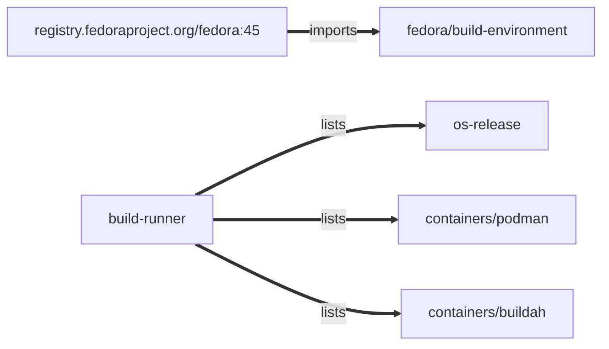

# `build-runner` capability graph

GENERATED FILE, do not edit.

An arrow points from a provider to what needs it, dotted for `after`,
which orders the build without requiring anything. Layers build left to
right.
A thick arrow points from a component to what it lists or imports.

## Capabilities

| Name | Kind | Provided by | Required by | After |
|---|---|---|---|---|
| `build-environment` | capability | `fedora/build-environment` |  |  |
| `buildah` | file | `containers/buildah` |  |  |
| `os-release` | capability | `os-release` |  |  |
| `package-manager/dnf5` | capability | `base` |  |  |
| `podman` | file | `containers/podman` |  |  |

## Imports

| Component | By | How |
|---|---|---|
| `fedora/build-environment` | `base-image/fedora-45` | imports |
| `os-release` | `build-runner` | lists |
| `containers/podman` | `build-runner` | lists |
| `containers/buildah` | `build-runner` | lists |
